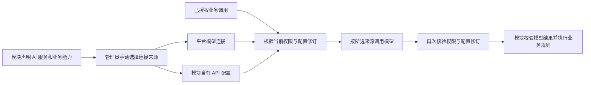

# 模块 AI 服务与连接配置

模块通过可选 `registration.ai_services` 声明实际使用 AI 的服务及其业务能力。主框架为每项服务保存明确的连接来源：停用、平台模型连接或模块自有连接。模型回答、连接测试与正式业务完成分别验证。

## 谁声明、谁保存、调用时如何确认

| 内容 | 声明或保存位置 | 调用规则 |
| --- | --- | --- |
| AI 服务标识、标题、说明、关联能力、支持来源 | 模块公开 `registration.ai_services`；Schema 在 `contracts/ai/v1/` | 登记时检查服务和能力属于本模块，旧无 AI 声明模块兼容 |
| 当前来源和平台模型连接编号 | 主框架独立实例的私有配置 | 管理员显式保存，使用配置修订防止覆盖；初始停用，不自动套用全局默认连接 |
| 平台 API 地址、模型、密钥与参数 | 主框架原有模型连接配置 | 平台源通过中央 broker 调用，密钥不下发模块 |
| 模块 API 地址、模型、密钥与参数 | 模块 AI SDK 的私有加密配置 | 主框架可代理管理员配置，公开状态不返回密钥；独立运行也能使用此配置 |
| 业务对象、正式状态和模型结果的采纳规则 | 模块自身仓储和业务代码 | 服务凭据、平台配置、模型回复均不增加用户权限，不代替领域校验或人工审核 |

## 模块接入

声明项包括 `id`、`title`、`description`、`capability_ids`、`supported_sources`。不在声明、清单、前端资源、源码示例或验收回执中填写真实 API Key。关联能力必须实际存在；没有 AI 行为的模块无需添加占位服务。

使用同批 Python/Node `AIServiceManager`，将模块自己的私有数据目录传给管理器，并通过同批服务 SDK 挂载 AI 配置与测试接口。模块独立运行时使用自有配置；连接平台时显式提供可信的平台地址，并在握手中要求 `ai-services-1.0` 功能。具体构造参数和请求字段以 `contracts/ai/v1/README.md` 与 SDK 为准。

业务代码传入当前调用的访问票据、请求编号、操作、权限，以及从可信仓储取得的范围事实。SDK 解析路由后，按已保存来源调用平台 broker 或自有 API；取得结果后重新验证当前授权和来源/配置修订，再交给业务代码校验。业务提交前仍应再次检查其持有的调用守卫。不得使用旧票据、客户端自报角色或模型文本替代授权。

## 管理员操作

在主框架“模型连接”页面中的模块 AI 服务区域选择模块服务。平台来源需明确选择一条已配置的模型连接；模块来源可编辑模块自己的地址、模型、密钥和参数。连接配置和来源绑定分别保存，未提交的表单不是已生效配置。密钥留空表示保留已有值；需要清除时使用明确的清除操作。

保存后使用连接测试核对当前选择。页面显示已保存来源、修订和密钥是否已配置，不展示密钥内容。读取/保存失败、模块离线、配置冲突或权限变化均显示实际错误，不能显示为已切换成功。页面与对话中的配置界面共用实现和管理员授权。

切换只对符合当前修订的调用生效。在途调用遇到来源、模块配置或授权改变时应明确拒绝其结果，不自动尝试另一连接。重新加载当前正式配置后，由操作者决定下一次调用。

路由引用中的 `platform_config_digest` 固定平台连接配置，模块来源时为 null。即使平台连接编号没变，修改其模型、地址或密钥也会让旧引用的最终复验失败。`chatWithReceipt` / `chat_with_receipt` 返回结果与无凭据路由引用，模块在最终本地提交前调用 `validate`；这提供前后复验，不构成跨服务分布式原子事务。

## 验收与存储边界

分别验证旧模块兼容、声明引用、平台/模块两种来源、停用、错误连接、配置修订冲突、当前撤权、在途切换、重启保存、密钥不回显与真实 API 调用。测试配置成功不能替代实际业务路径验证；模型候选仍须经过模块的数据校验和原有审核。

平台密钥沿用现有私有模型存储；模块 SDK 加密配置与本地密钥文件一起保存在模块私有目录。加密不保护能读取整个目录和进程的攻击者，Windows 部署应为模块数据目录设置实际账户访问权限。运行数据和凭据不随两个框架的源码包交付。

本功能属于 v0.02 之后的本地适配候选，协议为独立的 AI 服务 1.0；发布标签与具体协议版本分别管理。真实接口、浏览器和业务测试结果以本轮验收记录为准。
