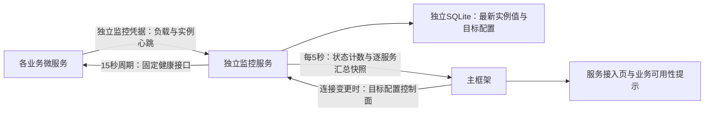

# 独立微服务监控中心

本轮设计：微服务健康、监控心跳与资源负载由独立进程接收和汇总；主框架每五秒读取一份有界快照。独立服务随主框架源码交付，有自己的端口、凭据、数据和启动停止命令。主 API 不接收负载报告，也不再逐服务执行后台健康探测。



## 边界

- 控制面同步已登记的服务标识、连接修订、固定健康地址及探测凭据，不传模型配置、业务数据、用户会话或用户授权数据库。
- 模块报告采用每服务独立的监控令牌，不可调用业务或管理目标。平台控制凭据不能作为模块报告令牌。服务探测凭据在独立存储中加密；只访问固定的健康路径，不执行能力接口。
- 健康状态、负载报告的新鲜程度与正式业务状态分别管理。没有报告的负载是未知，不以零冒充；浏览器presence不是服务负载。已有业务运行观察保留其单次调用票据和当前授权核验，技术监控不承接这些业务语义。
- 原模块无需修改即可继续提供健康检查。需要负载的模块配置报告客户端；可独立选择技术栈，实现同一HTTP协议。

## 限额与聚合

- 每实例报告最多8 KiB，字段白名单；不接收任意日志、消息、输入输出或密钥。报告包含实例、启动批次、单调序号、运行时长和可选的CPU百分比、RSS、并发数、队列深度、请求/错误计数。
- 每服务最多16个实例；每实例最多每秒一次报告；最新值覆盖保存，不为每次心跳追加历史。过期实例不参与当前负载聚合。允许有界去重，拒绝旧序号和已退休的启动批次。
- CPU以各新鲜实例的平均值表示，内存/并发/队列求和；缺失值保持null。计数是当前新鲜进程的累计值，不冒充跨重启的历史总量。
- 健康探测周期15秒、单次5秒、最多4并发；连续3次失败为offline，45秒未检查为stale。进程重启先unknown，不把旧时间戳重置为健康。
- 主框架只维护最近完整快照和采集时间；并发刷新合并，故障采用有界退避，不按页面数量增加对独立服务的请求。独立服务不可达时显示不可用/未知，不把所有业务服务标为离线；实际业务调用仍执行原来的授权、修订及HTTP检查。

## 生命周期与验收要求

独立服务单独启动/停止；主平台停止后监控继续运行。停止必须核验PID、创建时间、命令及cwd；不按端口杀进程。主框架启动脚本准备或复用本实例的独立监控，不连接其他实例或旧8030。

验收包括：四服务健康汇总、真实报告协议、鉴权隔离、报告限额/重复/乱序/过期、多实例聚合、目标更新使旧结果失效、监控重启、监控不可用时主框架业务可用、主框架停止后监控仍接收、批量报告仅导致固定频率快照读取、页面/对话原流程回归。实现与结果分别记录，尚未执行不记通过。

该服务提供DuoFlow的技术状态聚合协议；本轮不声称部署了Celery、Prometheus或OpenTelemetry集群。它不提供分布式业务事务、自动扩容或生产高可用保证。

## 主框架仓库中的启动操作

在主框架的`common-platform`目录运行。正常启动脚本自动准备或复用同一实例的独立监控；默认API8030、监控8032，可显式改变端口。端口占用或实例身份不同会拒绝启动，不停止占用者。

```powershell
.\scripts\start.ps1 -Port 8030 -DataDirectory .\data\my-platform -MonitorPort 8032
.\scripts\stop.ps1 -DataDirectory .\data\my-platform
# 上一命令只停止API；独立监控继续运行。单独检查和停止：
.\.venv\Scripts\python.exe scripts/monitor_service.py status --data-directory .\data\my-platform-monitor
.\.venv\Scripts\python.exe scripts/monitor_service.py stop --data-directory .\data\my-platform-monitor
```

如需单独启动监控，执行`monitor_service.py start --platform-data <平台数据目录> --data-directory <独立监控目录> --port <监控端口>`。使用`uvicorn app.main:app`手动运行API时，仍需先配置并启动独立监控；未配置会明确显示状态未知，不自动恢复进程内探测。

管理员在“服务接入”查看独立监控汇总、每服务健康和选定服务的负载。主API及监控进程的数据目录独立；备份或迁移时分别处理，不复制旧实例凭据来建立新实例。

## 模块直接报告

在主框架同步目标后，部署者将本服务报告凭据写到新的私有文件（不能放入源码、前端包或对话）：

```powershell
.\.venv\Scripts\python.exe scripts/monitor_service.py credentials --data-directory .\data\my-platform-monitor --platform-data .\data\my-platform --service-id demo-service --output .\data\demo-service-monitor.json
```

Node模板设置`DUOFLOW_MONITOR_CONFIG_FILE`指向该私有文件；模板会在监听后启动采样，关闭时停止。其CPU、RSS和HTTP并发/请求/错误计数来自实际进程；未提供业务队列深度时保持未知。多个实例应配置稳定且各不相同的`instance_id`，每次启动的`boot_id`由SDK自动生成。

既有Node服务可使用`createTelemetryReporter({url,token,instanceId,metrics})`，Python使用`TelemetryReporter(url=...,token=...,instance_id=...,metrics=...)`，显式调用`start()`／`stop()`。`metrics`只允许业务运行器提供并发、队列和请求/错误计数；不能把业务输入输出当监控数据。CPU归一到SDK可见核数，RSS是进程内存；容器配额或专用GPU指标需单独适配，本轮不推断。

模块报告令牌、平台控制令牌和探测Bearer分别管理；私有目录需设置部署账户访问权限。本地加密不保护能读取整个目录和进程的攻击者。配置报告不会新增业务用户权限。
